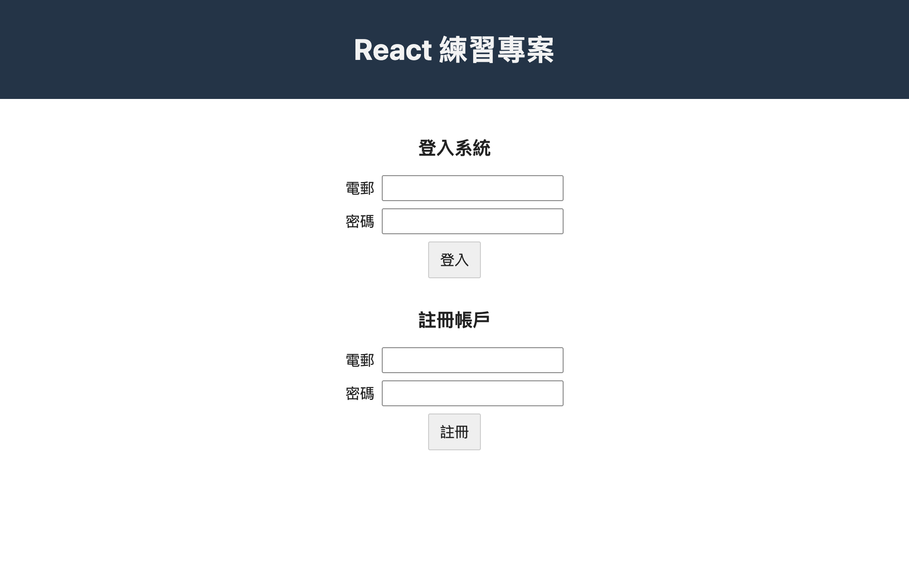
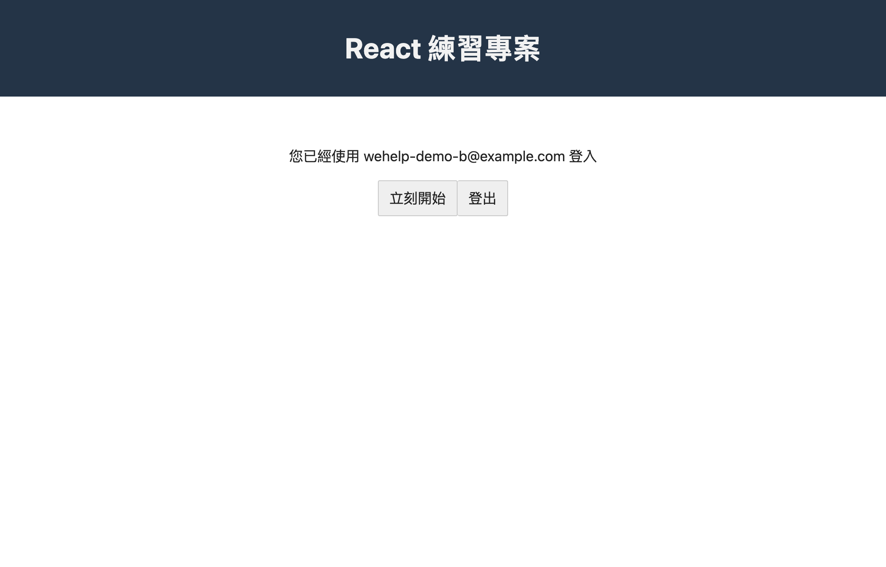
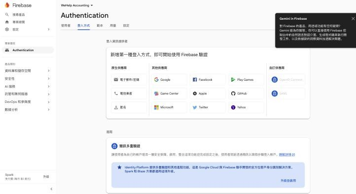
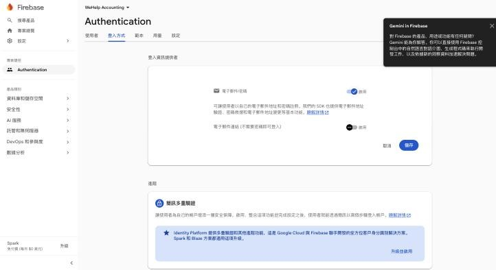
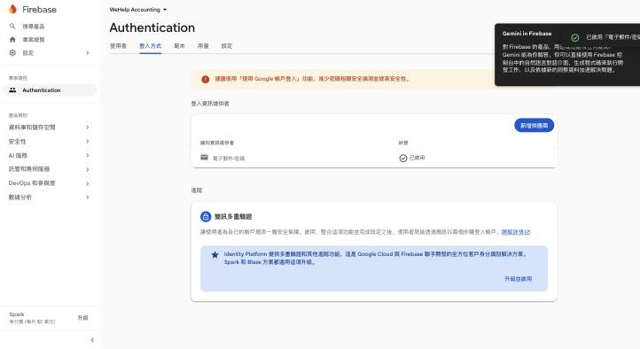
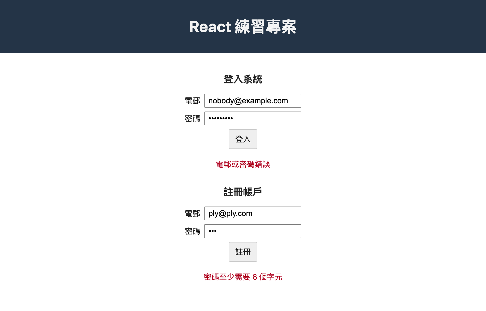
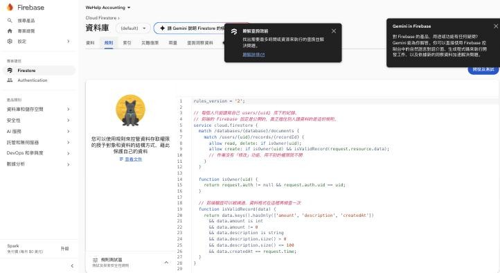
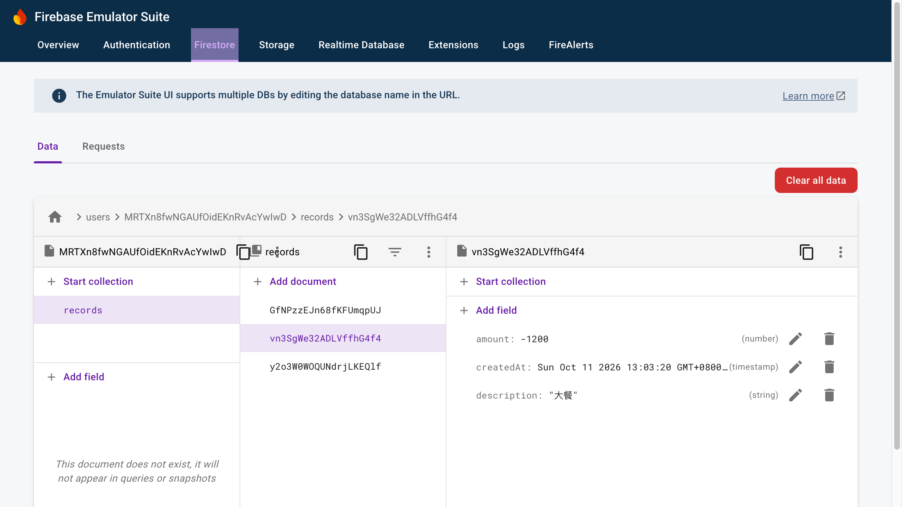

# 第二週教學：記帳小工具接上 Firebase（會員登入 + 雲端資料庫）

> 接續 [第一週教學](./TUTORIAL.md)。照順序做，每一步都說明「做什麼、為什麼這樣做、做完應該看到什麼」。
> 本文程式碼都實際跑過：ESLint、TypeScript、20 個單元測試、18 個安全規則測試、production build 全部通過；R1–R7 在本機 Emulator 和線上正式環境都實測過，包含用另一個帳號的登入憑證直接呼叫 Firestore API，讀、刪、新增別人的資料都被拒絕（HTTP 403）。

---

## 目錄

0. [這週要做出什麼](#0-這週要做出什麼)
1. [先懂五個觀念](#1-先懂五個觀念)
2. [建立 Firebase 專案](#2-建立-firebase-專案)
3. [安裝套件與環境變數](#3-安裝套件與環境變數)
4. [一步一步寫程式](#4-一步一步寫程式)
5. [安全規則：真正擋住別人看你資料的地方](#5-安全規則真正擋住別人看你資料的地方)
6. [Emulator：在自己電腦上開發，不碰正式資料](#6-emulator在自己電腦上開發不碰正式資料)
7. [測試與 CI](#7-測試與-ci)
8. [部署到 Vercel 並驗收](#8-部署到-vercel-並驗收)
9. [卡關了怎麼辦](#9-卡關了怎麼辦)
10. [報告時可以講的重點](#10-報告時可以講的重點)

---

## 0. 這週要做出什麼

| 未登入的首頁                                     | 已登入的首頁                               |
| ------------------------------------------------ | ------------------------------------------ |
|  |  |

**記帳頁**：資料存在 Firebase，關掉瀏覽器再回來還在；每個人只看得到自己的。


### 驗收清單（從簡報拆出來的）

| #   | 需求               | 怎麼驗收                                       |
| --- | ------------------ | ---------------------------------------------- |
| R1  | 新增寫進資料庫     | 新增後在 Firebase Console 看得到               |
| R2  | 刪除從資料庫刪掉   | 刪除後 Console 也不見                          |
| R3  | 回訪看得到上次資料 | 關掉瀏覽器再開，紀錄還在                       |
| R4  | 可以註冊           | 註冊後 Console 的 Authentication 出現該使用者  |
| R5  | 可以登入、登出     | 首頁顯示「您已經使用 xxx 登入」；登出回到表單  |
| R6  | 沒登入不能記帳     | 直接打 `/accounting` 會被導回 `/`              |
| R7  | 只看得到自己的     | A、B 互相看不到；B 自己寫程式也讀不到 A 的資料 |

### 整體架構

```
瀏覽器（Next.js）
 ├─ Firebase Authentication：註冊、登入、記住登入狀態
 └─ Cloud Firestore：users/{uid}/records/{recordId}
                     └─ 安全規則：只有 uid 本人能讀、能新增、能刪除
```

我們**沒有自己的後端**。瀏覽器直接跟 Firebase 說話，所以「誰能讀什麼」全靠 Firestore 的安全規則（§5）。

---

## 1. 先懂五個觀念

### 1.1 Firebase 是什麼

Google 提供的一組現成服務。這週用兩個：

| 服務                | 幫你做什麼                     | 不用它的話你要自己做           |
| ------------------- | ------------------------------ | ------------------------------ |
| **Authentication**  | 註冊、登入、密碼加密、記住登入 | 寫後端、存密碼雜湊、管 session |
| **Cloud Firestore** | 雲端資料庫，瀏覽器可以直接讀寫 | 架資料庫、寫 API               |

免費的 **Spark 方案不用綁信用卡**，Firestore 每天 5 萬次讀、2 萬次寫，做作業綽綽有餘。

### 1.2 Firestore 的資料長相：集合與文件

想像成「資料夾」和「JSON 檔案」：

```
users                       ← 集合（資料夾）
└─ MRTXn8fw...（某人的 uid） ← 文件
   └─ records               ← 子集合
      ├─ GfNPzz...          ← 一筆紀錄（文件）
      │    amount: 50000
      │    description: "十月份薪資"
      │    createdAt: 2026-10-11 13:03
      └─ vn3SgW...
```

**為什麼放在 `users/{uid}/records` 底下？** 路徑本身就把每個人的資料分開了，安全規則只要檢查「路徑裡的 uid 是不是你」就好（§5），很難寫錯。

### 1.3 登入狀態有三種，不是兩種

Firebase 讀取「上次有沒有登入」需要一點時間。所以 `user` 會有三種值：

| 值          | 意思               | 畫面           |
| ----------- | ------------------ | -------------- |
| `undefined` | 還不知道（正在讀） | 「載入中…」    |
| `null`      | 確定沒登入         | 登入／註冊表單 |
| `User` 物件 | 已登入             | 顯示 email     |

**最常見的 bug**：只分「有 user／沒 user」。頁面一載入時 user 還沒讀到，記帳頁就把已登入的人踢回首頁。

### 1.4 資料操作的標準順序（簡報 Slide 6）

```
使用者按刪除 → 命令資料庫刪除 → 資料庫刪除成功 → 才更新畫面
                              └→ 失敗：畫面不動，顯示錯誤
```

第一週沒有資料庫，按刪除直接改畫面。這週如果還是先改畫面、資料庫卻失敗（斷網、權限不足），使用者會看到「刪掉了」，重新整理又跑回來。**畫面要反映資料庫的真實狀態。**

下面是故意讓資料庫拒絕刪除時的畫面：紀錄還在，並顯示錯誤。這就是順序正確的證明。


### 1.5 Firebase 設定是公開的，安全靠規則

`apiKey` 這些設定會被打包進前端程式，任何人打開瀏覽器開發者工具都看得到。**這是正常的**，它只是用來告訴 Firebase「我是哪個專案」，不是密碼。

所以如果只在畫面上「只顯示自己的資料」，別人照樣可以拿這組設定，自己寫程式讀你的資料庫。**真正的保護是 §5 的安全規則。**

---

## 2. 建立 Firebase 專案

> 官方說明（有截圖）：https://firebase.google.com/docs/web/setup

### 2.1 建立專案

1. 打開 https://console.firebase.google.com/ ，用 Google 帳號登入
2. **建立專案** → 名稱輸入 `WeHelp Accounting`
3. Google Analytics：**不用開**（這次用不到）
4. 等它建立完成 → **繼續**

建好後左下角會顯示 **Spark（免付費）**。**不要按「升級」**。

### 2.2 開啟 Authentication 的電子郵件／密碼登入

1. 左邊選單 **Authentication** → **開始使用**
2. **登入方式** 分頁 → 在「原生供應商」點 **電子郵件/密碼**



3. 打開第一個開關「電子郵件/密碼」→ **儲存**
   - 第二個「電子郵件連結（不需要密碼即可登入）」**不用開**



4. 看到狀態是「**已啟用**」就完成了



### 2.3 建立 Firestore 資料庫

1. 左邊選單 **資料庫和儲存空間** → **Firestore** → **建立資料庫**
2. 版本選 **Standard**（標準版）
3. 位置選 **asia-east1（台灣）**
   - **為什麼？** 離使用者近比較快。**位置建立後不能改。**
4. 安全規則選「**以正式版模式啟動**」（production mode）
   - **為什麼不選測試模式？** 測試模式的預設規則是「**30 天內所有人都能讀寫**」，等於資料庫大門敞開。正式版模式預設全部拒絕，我們在 §5 再開放剛好需要的權限。
5. **建立**

### 2.4 註冊網頁應用程式，拿到設定

1. 左上角齒輪 → **專案設定** → **一般** 分頁
2. 往下到「你的應用程式」→ 點 **`</>`（網頁）**
3. 應用程式暱稱：`wehelp-accounting`；**不用**勾 Firebase Hosting（我們用 Vercel）→ **註冊應用程式**
4. 畫面會出現一段 `const firebaseConfig = { apiKey: "...", ... }`，**先複製起來**，§3.2 要用

---

## 3. 安裝套件與環境變數

### 3.1 安裝

```bash
git switch -c feat/firebase
pnpm add firebase
pnpm add -D firebase-tools @firebase/rules-unit-testing
```

| 套件                           | 用途                                |
| ------------------------------ | ----------------------------------- |
| `firebase`                     | 前端 SDK：登入、讀寫 Firestore      |
| `firebase-tools`               | Firebase CLI，用來跑 Emulator（§6） |
| `@firebase/rules-unit-testing` | 測試安全規則（§5.3）                |

> 寫這篇時 `firebase` 最新是 13.0.0。13 版的破壞性變更只在 AI Logic，本文用到的 Auth、Firestore 函式都沒變（實際安裝檢查過）。`@firebase/rules-unit-testing` 6.0 需要 **Node 24.12 以上**。

pnpm 12 預設不讓套件執行安裝腳本，`pnpm install` 會列出被擋的套件並失敗。這幾個我們都用不到它的安裝腳本，在 `pnpm-workspace.yaml` 明確設成 `false`：

```yaml
allowBuilds:
  '@firebase/util': false
  protobufjs: false
  re2: false
  sharp: false
  unrs-resolver: false
```

### 3.2 環境變數

新增 `.env.example`（**會** commit，只列名字，給別人知道要設哪些）：

```bash
# Firebase Console → 專案設定 → 一般 → 你的應用程式 → SDK 設定和配置
# 複製成 .env.local 填入。這些值會出現在瀏覽器裡，本來就是公開的；資料安全靠 firestore.rules。
NEXT_PUBLIC_FIREBASE_API_KEY=
NEXT_PUBLIC_FIREBASE_AUTH_DOMAIN=
NEXT_PUBLIC_FIREBASE_PROJECT_ID=
NEXT_PUBLIC_FIREBASE_STORAGE_BUCKET=
NEXT_PUBLIC_FIREBASE_MESSAGING_SENDER_ID=
NEXT_PUBLIC_FIREBASE_APP_ID=
```

複製一份成 `.env.local`（**不會** commit），把 §2.4 的值填進去：

```bash
cp .env.example .env.local
```

`.gitignore` 要確保 `.env.local` 不會上傳、`.env.example` 會上傳：

```
.env*
!.env.example
```

**為什麼要 `NEXT_PUBLIC_` 開頭？** Next.js 只會把這個開頭的變數打包進瀏覽器程式。沒有這個開頭，前端讀到的會是 `undefined`。

**改了 `.env.local` 要重啟 `pnpm dev`** 才會生效。

---

## 4. 一步一步寫程式

### 4.0 檔案總覽

```
app/
├── layout.tsx              ← 用 AuthProvider 包住整個網站
├── page.tsx                ← 首頁：登入／註冊，或顯示已登入
└── accounting/page.tsx     ← 記帳頁：沒登入就導回首頁
components/
├── AuthProvider.tsx        ← 管理「現在誰登入」，給所有頁面用
├── AuthForm.tsx            ← 登入、註冊共用的表單
├── RecordsPanel.tsx        ← 某個人的記帳區：讀取、新增、刪除
├── RecordForm.tsx          ← 新增紀錄表單（第一週改來的）
└── RecordList.tsx          ← 紀錄列表（第一週改來的）
lib/
├── firebase.ts             ← 初始化 Firebase
├── auth.ts                 ← 註冊、登入、登出、錯誤訊息翻譯
├── records-repo.ts         ← 所有 Firestore 讀寫都在這裡
└── records.ts              ← 純邏輯：驗證輸入、算小計
types/record.ts
firestore.rules             ← 安全規則
```

**分層的想法**：頁面和組件只管畫面；碰 Firebase 的程式集中在 `lib/`。哪天換資料庫，只改 `records-repo.ts`，畫面一行都不用動。

### 4.1 資料型別：`types/record.ts`

```ts
export type RecordType = 'income' | 'expense'

/** 存進資料庫的內容：收入為正數、支出為負數，加總就是小計 */
export interface NewRecord {
  amount: number
  description: string
}

/** 從資料庫讀出來的紀錄，多了 Firestore 產生的 id */
export interface AccountRecord extends NewRecord {
  id: string
}
```

**為什麼分兩個型別？** 「要存進去的資料」（`NewRecord`）還沒有 id，id 是 Firestore 存完才產生的；「讀出來的紀錄」（`AccountRecord`）才有 id。分開寫，TypeScript 會幫你抓「拿還沒存的資料當成有 id」這種錯誤。

### 4.2 純邏輯：`lib/records.ts`

```ts
import type { AccountRecord, NewRecord, RecordType } from '@/types/record'

export const MAX_DESCRIPTION_LENGTH = 100
/** 單筆金額上限（10 億），安全規則也用同一個數字 */
export const MAX_AMOUNT = 1_000_000_000

export interface RecordInput {
  type: RecordType
  amount: string
  description: string
}

export type ParseResult = { ok: true; record: NewRecord } | { ok: false; error: string }

/** 把表單輸入轉成要存的資料；id 和時間交給資料庫產生 */
export function parseRecordInput(input: RecordInput): ParseResult {
  const amount = Number(input.amount)
  const description = input.description.trim()

  if (!Number.isInteger(amount) || amount <= 0) {
    return { ok: false, error: '金額請輸入大於 0 的整數' }
  }
  if (amount > MAX_AMOUNT) {
    return { ok: false, error: '單筆金額最多 10 億' }
  }
  if (description === '') {
    return { ok: false, error: '請輸入說明' }
  }
  if (description.length > MAX_DESCRIPTION_LENGTH) {
    return { ok: false, error: `說明最多 ${MAX_DESCRIPTION_LENGTH} 個字` }
  }

  return {
    ok: true,
    record: { amount: input.type === 'income' ? amount : -amount, description },
  }
}

export function removeRecord(records: AccountRecord[], id: string): AccountRecord[] {
  return records.filter((record) => record.id !== id)
}

export function calcSubtotal(records: AccountRecord[]): number {
  return records.reduce((sum, record) => sum + record.amount, 0)
}
```

跟第一週比的改變：

- `createRecord` 改名 `parseRecordInput`，**不再產生 id**：id 交給 Firestore。
- 多了說明最多 100 字的限制，跟 §5 的安全規則一致。
- `Number.isSafeInteger`：比 `isInteger` 多擋掉 `1e30` 這種大到不精確的數字。

這個檔案沒有 Firebase、沒有 React，所以最好測試（§7）。

### 4.3 初始化 Firebase：`lib/firebase.ts`

```ts
import { getApp, getApps, initializeApp } from 'firebase/app'
import { type Auth, connectAuthEmulator, getAuth } from 'firebase/auth'
import { type Firestore, connectFirestoreEmulator, getFirestore } from 'firebase/firestore'

interface FirebaseServices {
  auth: Auth
  db: Firestore
}

let services: FirebaseServices | null = null

/**
 * 第一次呼叫時才初始化。只在瀏覽器裡（useEffect、事件處理）呼叫，
 * 這樣 next build 預先產生頁面時不會因為沒有環境變數而失敗。
 */
export function getFirebase(): FirebaseServices {
  if (services) return services

  const app = getApps().length
    ? getApp()
    : initializeApp({
        apiKey: process.env.NEXT_PUBLIC_FIREBASE_API_KEY,
        authDomain: process.env.NEXT_PUBLIC_FIREBASE_AUTH_DOMAIN,
        projectId: process.env.NEXT_PUBLIC_FIREBASE_PROJECT_ID,
        storageBucket: process.env.NEXT_PUBLIC_FIREBASE_STORAGE_BUCKET,
        messagingSenderId: process.env.NEXT_PUBLIC_FIREBASE_MESSAGING_SENDER_ID,
        appId: process.env.NEXT_PUBLIC_FIREBASE_APP_ID,
      })
  const auth = getAuth(app)
  const db = getFirestore(app)

  // 本機開發可以接 Firebase Emulator，不碰正式資料
  if (process.env.NEXT_PUBLIC_USE_FIREBASE_EMULATOR === 'true') {
    connectAuthEmulator(auth, 'http://127.0.0.1:9099', { disableWarnings: true })
    connectFirestoreEmulator(db, '127.0.0.1', 8080)
  }

  services = { auth, db }
  return services
}
```

**為什麼不直接在檔案最上面 `const auth = getAuth(app)`？**

Next.js 在 `pnpm build` 時，會先在伺服器上把頁面跑一次產生 HTML。如果模組一載入就初始化 Firebase Auth，build（或沒有環境變數的 CI）就可能失敗。所以包成 `getFirebase()`，**第一次在瀏覽器裡用到時才初始化**，之後重複使用同一份。

`getApps().length ? getApp() : initializeApp(...)`：開發時存檔會熱更新，避免重複初始化報錯。

最後那段 Emulator 設定讓本機開發可以不碰正式資料（§6）。

### 4.4 登入功能：`lib/auth.ts`

```ts
import { FirebaseError } from 'firebase/app'
import {
  createUserWithEmailAndPassword,
  signInWithEmailAndPassword,
  signOut as firebaseSignOut,
} from 'firebase/auth'
import { getFirebase } from '@/lib/firebase'

export async function signUp(email: string, password: string): Promise<void> {
  await createUserWithEmailAndPassword(getFirebase().auth, email, password)
}

export async function signIn(email: string, password: string): Promise<void> {
  await signInWithEmailAndPassword(getFirebase().auth, email, password)
}

export async function signOut(): Promise<void> {
  await firebaseSignOut(getFirebase().auth)
}

const AUTH_ERROR_MESSAGES: Record<string, string> = {
  'auth/email-already-in-use': '這個電郵已經註冊過了',
  'auth/invalid-email': '電郵格式不正確',
  'auth/missing-password': '請輸入密碼',
  'auth/weak-password': '密碼至少需要 6 個字元',
  // 正式環境開了「電子郵件列舉保護」只會回 invalid-credential；
  // Emulator 和舊專案會分成帳號不存在／密碼錯誤，一律用同一句話，不透露帳號是否存在
  'auth/invalid-credential': '電郵或密碼錯誤',
  'auth/user-not-found': '電郵或密碼錯誤',
  'auth/wrong-password': '電郵或密碼錯誤',
  'auth/too-many-requests': '嘗試次數太多，請稍後再試',
  'auth/network-request-failed': '網路連線失敗，請檢查網路',
}

/** 把 Firebase 的錯誤代碼翻成給使用者看的訊息 */
export function authErrorMessage(error: unknown): string {
  const code = error instanceof FirebaseError ? error.code : ''
  return AUTH_ERROR_MESSAGES[code] ?? '發生錯誤，請稍後再試'
}
```

- 包一層 `signUp`／`signIn`／`signOut`：頁面不用知道 Firebase 的函式名稱。
- **錯誤訊息翻譯**：Firebase 丟出來的是 `auth/weak-password` 這種代碼，使用者看不懂。
- **帳號不存在和密碼錯誤顯示同一句話**：如果分開說「沒有這個帳號」，等於告訴壞人哪些 email 有註冊。正式專案預設開啟「電子郵件列舉保護」，本來就只會回 `invalid-credential`；Emulator 會分開回，所以我們三種代碼都對應到同一句。

### 4.5 管理登入狀態：`components/AuthProvider.tsx`

```tsx
'use client'

import { onAuthStateChanged, type User } from 'firebase/auth'
import { createContext, useContext, useEffect, useState, type ReactNode } from 'react'
import { getFirebase } from '@/lib/firebase'

interface AuthState {
  /** undefined：還不知道（Firebase 正在讀上次的登入資訊）；null：沒登入 */
  user: User | null | undefined
}

const AuthContext = createContext<AuthState>({ user: undefined })

export function AuthProvider({ children }: { children: ReactNode }) {
  const [user, setUser] = useState<User | null | undefined>(undefined)

  useEffect(() => onAuthStateChanged(getFirebase().auth, setUser), [])

  return <AuthContext.Provider value={{ user }}>{children}</AuthContext.Provider>
}

export function useAuth(): AuthState {
  return useContext(AuthContext)
}
```

- `onAuthStateChanged`：登入、登出、或一打開頁面讀到上次的登入時，都會呼叫 `setUser`。
- 它會回傳「取消監聽」的函式，直接當 `useEffect` 的回傳值，離開時自動清掉。
- **React Context**：在 `layout.tsx` 包一次，任何頁面 `useAuth()` 就拿得到 `user`，不用一層層傳 props。
- 初始值是 `undefined`（還不知道），對應 §1.3 的三種狀態。

在 `app/layout.tsx` 包起來：

```tsx
import type { Metadata } from 'next'
import { AuthProvider } from '@/components/AuthProvider'
import './globals.css'

export const metadata: Metadata = {
  title: 'React 練習專案',
  description: 'WeHelp 記帳小工具',
}

export default function RootLayout({ children }: LayoutProps<'/'>) {
  return (
    <html lang="zh-Hant">
      <body>
        <AuthProvider>{children}</AuthProvider>
      </body>
    </html>
  )
}
```

### 4.6 登入／註冊表單：`components/AuthForm.tsx`

```tsx
'use client'

import { useId, useState, type FormEvent } from 'react'
import { authErrorMessage } from '@/lib/auth'

interface AuthFormProps {
  title: string
  submitLabel: string
  onSubmit: (email: string, password: string) => Promise<void>
}

/** 登入和註冊共用：欄位一樣，只有標題、按鈕文字和送出後做的事不同 */
export default function AuthForm({ title, submitLabel, onSubmit }: AuthFormProps) {
  const id = useId()
  const [email, setEmail] = useState('')
  const [password, setPassword] = useState('')
  const [error, setError] = useState('')
  const [submitting, setSubmitting] = useState(false)

  async function handleSubmit(event: FormEvent<HTMLFormElement>) {
    event.preventDefault()
    setSubmitting(true)
    setError('')
    try {
      await onSubmit(email.trim(), password)
    } catch (err) {
      setError(authErrorMessage(err))
    } finally {
      setSubmitting(false)
    }
  }

  return (
    <form className="auth-form" onSubmit={handleSubmit}>
      <h2>{title}</h2>
      <div className="auth-form__field">
        <label htmlFor={`${id}-email`}>電郵</label>
        <input
          id={`${id}-email`}
          type="email"
          autoComplete="email"
          required
          value={email}
          onChange={(e) => setEmail(e.target.value)}
        />
      </div>
      <div className="auth-form__field">
        <label htmlFor={`${id}-password`}>密碼</label>
        <input
          id={`${id}-password`}
          type="password"
          autoComplete={submitLabel === '註冊' ? 'new-password' : 'current-password'}
          required
          value={password}
          onChange={(e) => setPassword(e.target.value)}
        />
      </div>
      <button type="submit" className="button" disabled={submitting}>
        {submitting ? '處理中…' : submitLabel}
      </button>
      {error && (
        <p className="form-error" role="alert">
          {error}
        </p>
      )}
    </form>
  )
}
```

- **登入和註冊共用一個組件**：欄位一模一樣，只有標題、按鈕文字、送出後做的事不同，用 props 傳進來。不要複製貼上兩份。
- `useId()`：同一頁有兩個表單，每個欄位的 `id` 不能重複，`<label htmlFor>` 才對得到。
- `type="email"`、`required`：瀏覽器先幫你擋掉格式明顯錯誤的輸入。
- `autoComplete`：讓密碼管理器知道這是「新密碼」還是「現在的密碼」。
- 送出中 `disabled`：避免連按送出兩次。

### 4.7 首頁：`app/page.tsx`

```tsx
'use client'

import Link from 'next/link'
import { useState } from 'react'
import AuthForm from '@/components/AuthForm'
import { useAuth } from '@/components/AuthProvider'
import { signIn, signOut, signUp } from '@/lib/auth'

export default function HomePage() {
  const { user } = useAuth()
  const [signOutError, setSignOutError] = useState('')

  async function handleSignOut() {
    setSignOutError('')
    try {
      await signOut()
    } catch {
      setSignOutError('登出失敗，請稍後再試')
    }
  }

  return (
    <>
      <header className="site-header">
        <h1>React 練習專案</h1>
      </header>
      <main className="home">
        {user === undefined && <p className="status">載入中…</p>}

        {user && (
          <section className="signed-in">
            <p>您已經使用 {user.email} 登入</p>
            <div className="button-group">
              <Link href="/accounting" className="button">
                立刻開始
              </Link>
              <button type="button" className="button" onClick={handleSignOut}>
                登出
              </button>
            </div>
            {signOutError && (
              <p className="form-error" role="alert">
                {signOutError}
              </p>
            )}
          </section>
        )}

        {user === null && (
          <>
            <AuthForm title="登入系統" submitLabel="登入" onSubmit={signIn} />
            <AuthForm title="註冊帳戶" submitLabel="註冊" onSubmit={signUp} />
          </>
        )}
      </main>
    </>
  )
}
```

三種狀態各顯示一種畫面（§1.3）。

**註冊成功後會自動登入**，這是 Firebase 的預設行為，所以畫面會直接變成「您已經使用 xxx 登入」。

簡報截圖裡已登入時下面還留著「註冊帳戶」表單。已登入的人不需要再註冊，所以這裡把它藏起來。

錯誤訊息的樣子：



### 4.8 資料庫讀寫：`lib/records-repo.ts`

```ts
import {
  addDoc,
  collection,
  deleteDoc,
  doc,
  getDocs,
  orderBy,
  query,
  serverTimestamp,
} from 'firebase/firestore'
import { getFirebase } from '@/lib/firebase'
import type { AccountRecord, NewRecord } from '@/types/record'

/** 每個使用者的紀錄放在 users/{uid}/records，安全規則只要比對路徑裡的 uid */
function recordsOf(uid: string) {
  return collection(getFirebase().db, 'users', uid, 'records')
}

/** 讀出某個使用者的所有紀錄，新的在前 */
export async function fetchRecords(uid: string): Promise<AccountRecord[]> {
  const snapshot = await getDocs(query(recordsOf(uid), orderBy('createdAt', 'desc')))
  return snapshot.docs.map((d) => ({
    id: d.id,
    amount: d.get('amount') as number,
    description: d.get('description') as string,
  }))
}

/** 等資料庫寫入成功才回傳（含 Firestore 產生的 id），呼叫的人再更新畫面 */
export async function addRecord(uid: string, record: NewRecord): Promise<AccountRecord> {
  const ref = await addDoc(recordsOf(uid), { ...record, createdAt: serverTimestamp() })
  return { id: ref.id, ...record }
}

/** 等資料庫刪除成功才回傳；失敗會丟出錯誤 */
export async function deleteRecord(uid: string, id: string): Promise<void> {
  await deleteDoc(doc(recordsOf(uid), id))
}
```

- `serverTimestamp()`：時間由 Firebase 伺服器填，不能被使用者亂改；也用來排序（新的在前）。
- **每個函式都 `await` 到資料庫完成才回傳**，失敗會丟出錯誤。呼叫的人據此決定要不要更新畫面（§1.4）。

> **為什麼不用 `onSnapshot` 即時監聽？**
> `onSnapshot` 很方便：資料庫一變就自動通知。但 Firestore 為了讓畫面感覺很快，會**先用本機快取假裝成功、馬上更新畫面**，伺服器拒絕再改回來。實測刪除失敗時，那一筆會先消失、再跑回來閃一下，剛好違反簡報要求的順序。
> 想用 `onSnapshot` 做多分頁即時同步，要另外處理「還沒被伺服器確認的變更」，對這份作業來說太複雜，所以用 `getDocs` + `await`。

### 4.9 記帳區：`components/RecordsPanel.tsx`

```tsx
'use client'

import { useCallback, useEffect, useState } from 'react'
import RecordForm from '@/components/RecordForm'
import RecordList from '@/components/RecordList'
import { calcSubtotal, removeRecord } from '@/lib/records'
import { addRecord, deleteRecord, fetchRecords } from '@/lib/records-repo'
import type { AccountRecord, NewRecord } from '@/types/record'

interface RecordsPanelProps {
  uid: string
}

/** 某一個使用者的記帳區。外面用 key={uid} 掛載，換人時整個重來，不會殘留上一個人的資料 */
export default function RecordsPanel({ uid }: RecordsPanelProps) {
  /** null：還沒讀到（讀取中或讀取失敗） */
  const [records, setRecords] = useState<AccountRecord[] | null>(null)
  const [loadFailed, setLoadFailed] = useState(false)
  const [deletingId, setDeletingId] = useState<string | null>(null)
  const [error, setError] = useState('')

  /** 回傳取消函式：已經離開頁面了，舊的結果才回來，就不要再去改畫面 */
  const load = useCallback(() => {
    let ignore = false
    fetchRecords(uid)
      .then((list) => {
        if (!ignore) setRecords(list)
      })
      .catch(() => {
        if (!ignore) setLoadFailed(true)
      })
    return () => {
      ignore = true
    }
  }, [uid])

  useEffect(() => load(), [load])

  function retry() {
    setLoadFailed(false)
    load()
  }

  // 先等資料庫新增成功，拿到 id 後才放進畫面；失敗的話錯誤會丟回 RecordForm 顯示
  async function handleAdd(record: NewRecord) {
    const saved = await addRecord(uid, record)
    setRecords((prev) => [saved, ...(prev ?? [])])
  }

  // 標準流程：使用者按刪除 → 命令資料庫刪除 → 資料庫刪除成功，才更新前端畫面
  async function handleDelete(id: string) {
    setDeletingId(id)
    setError('')
    try {
      await deleteRecord(uid, id)
      setRecords((prev) => (prev ? removeRecord(prev, id) : prev))
    } catch {
      setError('刪除失敗，請稍後再試')
    } finally {
      setDeletingId(null)
    }
  }

  return (
    <>
      {/* 第一次讀取完成前不能新增：避免讀取結果回來時蓋掉剛新增的那筆 */}
      <RecordForm onAdd={handleAdd} disabled={records === null} />
      {error && (
        <p className="form-error" role="alert">
          {error}
        </p>
      )}
      {loadFailed ? (
        <div className="status">
          <p role="alert">讀取紀錄失敗</p>
          <button type="button" className="button" onClick={retry}>
            重新讀取
          </button>
        </div>
      ) : records === null ? (
        <p className="status">載入中…</p>
      ) : (
        <>
          <RecordList records={records} deletingId={deletingId} onDelete={handleDelete} />
          <p className="subtotal">
            <strong>小計：</strong>
            {calcSubtotal(records)}
          </p>
        </>
      )}
    </>
  )
}
```

- `records` 一開始是 `null`：代表「還沒讀到」，顯示「載入中…」。跟「讀到了但是空的」（顯示「目前沒有紀錄」）分開。
- `ignore`：如果讀取還沒回來使用者就離開了，舊的結果不要再去改畫面。
- **讀取完成前停用表單**：不然使用者趁讀取時新增一筆，讀取結果回來會把它蓋掉。
- **讀取失敗**：顯示「讀取紀錄失敗」和「重新讀取」按鈕，不會一直卡在「載入中…」。
- **`handleAdd`**：`await addRecord` 成功、拿到 id，才放進畫面。
- **`handleDelete`**：`await deleteRecord` 成功，才從畫面移除；失敗顯示錯誤，紀錄留著。這就是 §1.4 的標準流程。

### 4.10 新增表單與列表：`RecordForm.tsx`、`RecordList.tsx`

```tsx
'use client'

import { useState, type FormEvent } from 'react'
import { parseRecordInput } from '@/lib/records'
import type { NewRecord, RecordType } from '@/types/record'

interface RecordFormProps {
  onAdd: (record: NewRecord) => Promise<void>
  /** 外面還沒準備好（例如紀錄還在讀取）時停用 */
  disabled?: boolean
}

export default function RecordForm({ onAdd, disabled = false }: RecordFormProps) {
  const [type, setType] = useState<RecordType>('income')
  const [amount, setAmount] = useState('')
  const [description, setDescription] = useState('')
  const [error, setError] = useState('')
  const [submitting, setSubmitting] = useState(false)

  async function handleSubmit(event: FormEvent<HTMLFormElement>) {
    event.preventDefault()

    const result = parseRecordInput({ type, amount, description })
    if (!result.ok) {
      setError(result.error)
      return
    }

    // 先等資料庫寫入成功，才清空表單；失敗就保留使用者輸入的內容
    setSubmitting(true)
    try {
      await onAdd(result.record)
      setAmount('')
      setDescription('')
      setError('')
    } catch {
      setError('新增失敗，請稍後再試')
    } finally {
      setSubmitting(false)
    }
  }

  return (
    <form className="record-form" onSubmit={handleSubmit}>
      {/* 送出中整組停用：避免使用者趁等待時改了欄位，成功後又被清空 */}
      <fieldset className="record-form__row" disabled={disabled || submitting}>
        <select
          aria-label="類型"
          value={type}
          onChange={(e) => setType(e.target.value as RecordType)}
        >
          <option value="income">收入</option>
          <option value="expense">支出</option>
        </select>
        <input
          aria-label="金額"
          type="number"
          min="1"
          step="1"
          placeholder="金額"
          value={amount}
          onChange={(e) => setAmount(e.target.value)}
        />
        <input
          aria-label="說明"
          placeholder="說明"
          value={description}
          onChange={(e) => setDescription(e.target.value)}
        />
        <button type="submit" className="button" disabled={submitting}>
          {submitting ? '新增中…' : '新增紀錄'}
        </button>
      </fieldset>
      {error && (
        <p className="form-error" role="alert">
          {error}
        </p>
      )}
    </form>
  )
}
```

跟第一週比：`onAdd` 變成非同步，**要等資料庫寫入成功才清空表單**；失敗就保留使用者打的字，不用重打。送出中用 `<fieldset disabled>` 把整組欄位停用，避免使用者趁等待時改了內容，成功後又被清空。

```tsx
import type { AccountRecord } from '@/types/record'

interface RecordListProps {
  records: AccountRecord[]
  deletingId: string | null
  onDelete: (id: string) => void
}

export default function RecordList({ records, deletingId, onDelete }: RecordListProps) {
  if (records.length === 0) {
    return <p className="record-list__empty">目前沒有紀錄</p>
  }

  return (
    <ul className="record-list">
      {records.map((record) => (
        <li key={record.id} className="record-list__item">
          <span className={record.amount > 0 ? 'amount amount--income' : 'amount amount--expense'}>
            {record.amount}
          </span>
          <span className="record-list__description">{record.description}</span>
          <button
            type="button"
            className="button"
            disabled={deletingId === record.id}
            onClick={() => onDelete(record.id)}
          >
            {deletingId === record.id ? '刪除中…' : '刪除'}
          </button>
        </li>
      ))}
    </ul>
  )
}
```

多了 `deletingId`：正在刪的那一筆按鈕顯示「刪除中…」並停用，避免重複按。

### 4.11 記帳頁：`app/accounting/page.tsx`

```tsx
'use client'

import Link from 'next/link'
import { useRouter } from 'next/navigation'
import { useEffect } from 'react'
import { useAuth } from '@/components/AuthProvider'
import RecordsPanel from '@/components/RecordsPanel'

export default function AccountingPage() {
  const { user } = useAuth()
  const router = useRouter()

  // 確定沒登入（null）才導回首頁；undefined 代表 Firebase 還在讀登入狀態，先等
  useEffect(() => {
    if (user === null) router.replace('/')
  }, [user, router])

  if (!user) {
    return <p className="status">載入中…</p>
  }

  return (
    <main className="accounting">
      <p className="signed-in-as">
        您已經使用 <strong>{user.email}</strong> 登入
      </p>
      <RecordsPanel key={user.uid} uid={user.uid} />
      <div className="center">
        <Link href="/" className="button">
          返回首頁
        </Link>
      </div>
    </main>
  )
}
```

- **守門**：`user === null`（確定沒登入）才導回首頁；`undefined` 時先顯示「載入中…」，避免把已登入的人誤踢出去（§1.3）。
- **`key={user.uid}`**：換了一個人登入，React 會把 `RecordsPanel` 整個重建，上一個人的資料不會殘留在畫面上。
- 前端守門只是體驗上的擋門；**真正擋住資料的是 §5 的規則**。

### 4.12 樣式

`app/globals.css` 新增登入表單、按鈕群組、錯誤訊息、停用按鈕的樣式，完整內容見 repo 的 [app/globals.css](../app/globals.css)。重點：

- `.auth-form__field`：「電郵」「密碼」標籤和輸入框同一行，跟簡報截圖一樣。
- `.button:disabled`：送出中、刪除中的按鈕變淡，讓使用者知道正在處理。

---

## 5. 安全規則：真正擋住別人看你資料的地方

### 5.1 規則檔：`firestore.rules`

```
rules_version = '2';

// 每個人只能讀寫自己 users/{uid} 底下的紀錄。
// 前端的 Firebase 設定是公開的，真正擋住別人讀資料的是這份規則。
service cloud.firestore {
  match /databases/{database}/documents {
    match /users/{uid}/records/{recordId} {
      allow read, delete: if isOwner(uid);
      allow create: if isOwner(uid) && isValidRecord(request.resource.data);
      // 作業沒有「修改」功能，用不到的權限就不開
    }
  }

  function isOwner(uid) {
    return request.auth != null && request.auth.uid == uid;
  }

  // 前端驗證可以被繞過，資料格式在這裡再檢查一次
  function isValidRecord(data) {
    return data.keys().hasOnly(['amount', 'description', 'createdAt'])
      && data.amount is int
      && data.amount != 0
      && data.amount >= -1000000000
      && data.amount <= 1000000000
      && data.description is string
      && data.description.size() > 0
      && data.description.size() <= 100
      && data.createdAt == request.time;
  }
}
```

逐條看：

| 規則                                                  | 意思                                                                    |
| ----------------------------------------------------- | ----------------------------------------------------------------------- |
| `allow read, delete: if isOwner(uid)`                 | 只能讀、刪路徑裡 uid 是自己的紀錄                                       |
| `allow create: if isOwner(uid) && isValidRecord(...)` | 只能在自己底下新增，而且格式要對                                        |
| 沒有 `update`                                         | 作業沒有修改功能，**用不到的權限就不開**                                |
| `hasOnly([...])`                                      | 不能偷塞其他欄位（例如 `isAdmin: true`）                                |
| `amount is int`、`!= 0`                               | 金額必須是非零整數                                                      |
| `>= -1000000000`、`<= 1000000000`                     | 金額不超過 ±10 億，跟前端一致；也避免超大整數在 JavaScript 裡失去精確度 |
| `description.size() <= 100`                           | 跟前端的 100 字限制一致                                                 |
| `createdAt == request.time`                           | 必須用 `serverTimestamp()`，不能自己填假時間                            |

**為什麼前端驗證過了，規則還要再驗一次？** 前端程式在使用者的瀏覽器裡，可以被改、被繞過。規則在 Firebase 伺服器上執行，使用者碰不到。

### 5.2 發布規則

Firebase Console → **Firestore** → **規則** 分頁 → 整份貼上 → **發布**。發布後會看到：



**把規則存在 repo 的 `firestore.rules`**，不要只存在 Console 裡：有版本紀錄、可以寫測試、報告時也方便展示。

### 5.3 測試規則：`rules-tests/firestore.rules.test.ts`

規則寫錯不會有任何錯誤訊息，只會默默地「太寬」或「太嚴」。所以要寫測試證明它真的擋得住：

```ts
import { readFileSync } from 'node:fs'
import {
  assertFails,
  assertSucceeds,
  initializeTestEnvironment,
  type RulesTestEnvironment,
} from '@firebase/rules-unit-testing'
import {
  addDoc,
  collection,
  deleteDoc,
  doc,
  getDocs,
  serverTimestamp,
  setDoc,
  updateDoc,
} from 'firebase/firestore'
import { afterAll, beforeAll, beforeEach, describe, it } from 'vitest'

let env: RulesTestEnvironment

beforeAll(async () => {
  env = await initializeTestEnvironment({
    projectId: 'demo-accounting',
    firestore: { rules: readFileSync('firestore.rules', 'utf8'), host: '127.0.0.1', port: 8080 },
  })
})

afterAll(() => env.cleanup())
beforeEach(() => env.clearFirestore())

const alice = () => env.authenticatedContext('alice').firestore()
const bob = () => env.authenticatedContext('bob').firestore()
const guest = () => env.unauthenticatedContext().firestore()

const valid = () => ({ amount: -50, description: '咖啡', createdAt: serverTimestamp() })

/** 用管理員身分（不受規則限制）先放一筆 alice 的資料 */
async function seedAliceRecord() {
  await env.withSecurityRulesDisabled(async (ctx) => {
    await setDoc(doc(ctx.firestore(), 'users/alice/records/r1'), {
      amount: 50000,
      description: '十月份薪資',
      createdAt: new Date(),
    })
  })
}

describe('讀取', () => {
  it('自己可以讀自己的紀錄', async () => {
    await seedAliceRecord()
    await assertSucceeds(getDocs(collection(alice(), 'users/alice/records')))
  })

  it('別人讀不到', async () => {
    await seedAliceRecord()
    await assertFails(getDocs(collection(bob(), 'users/alice/records')))
  })

  it('沒登入讀不到', async () => {
    await seedAliceRecord()
    await assertFails(getDocs(collection(guest(), 'users/alice/records')))
  })
})

describe('新增', () => {
  it('自己可以新增合法紀錄', async () => {
    await assertSucceeds(addDoc(collection(alice(), 'users/alice/records'), valid()))
  })

  it('不能幫別人新增', async () => {
    await assertFails(addDoc(collection(bob(), 'users/alice/records'), valid()))
  })

  it('沒登入不能新增', async () => {
    await assertFails(addDoc(collection(guest(), 'users/alice/records'), valid()))
  })

  it.each([
    ['金額是 0', { amount: 0 }],
    ['金額是小數', { amount: 1.5 }],
    ['金額是字串', { amount: '100' }],
    ['金額超過 10 億', { amount: 1_000_000_001 }],
    ['金額低於 -10 億', { amount: -1_000_000_001 }],
    ['說明是空字串', { description: '' }],
    ['說明超過 100 字', { description: '字'.repeat(101) }],
    ['時間不是伺服器時間', { createdAt: new Date('2000-01-01') }],
    ['多了其他欄位', { isAdmin: true }],
  ])('%s → 拒絕', async (_, override) => {
    await assertFails(
      addDoc(collection(alice(), 'users/alice/records'), { ...valid(), ...override })
    )
  })
})

describe('刪除與修改', () => {
  it('自己可以刪除', async () => {
    await seedAliceRecord()
    await assertSucceeds(deleteDoc(doc(alice(), 'users/alice/records/r1')))
  })

  it('別人不能刪', async () => {
    await seedAliceRecord()
    await assertFails(deleteDoc(doc(bob(), 'users/alice/records/r1')))
  })

  it('沒有修改功能，連自己也不能改', async () => {
    await seedAliceRecord()
    await assertFails(updateDoc(doc(alice(), 'users/alice/records/r1'), { amount: 1 }))
  })
})
```

- `authenticatedContext('alice')`：假裝自己是 alice 登入。
- `assertSucceeds`／`assertFails`：預期成功／預期被拒絕。
- `withSecurityRulesDisabled`：用管理員身分先放測試資料（不受規則限制）。

測試設定（跟一般單元測試分開，因為它要連 Emulator）：

```ts
import { defineConfig } from 'vitest/config'

// 安全規則測試要連 Firestore Emulator，用 pnpm test:rules 執行
export default defineConfig({
  test: { include: ['rules-tests/**/*.test.ts'], testTimeout: 15000 },
})
```

```ts
import { fileURLToPath } from 'node:url'
import { defineConfig } from 'vitest/config'

export default defineConfig({
  resolve: { alias: { '@': fileURLToPath(new URL('./', import.meta.url)) } },
  test: { include: ['lib/**/*.test.ts'] },
})
```

執行（會自動啟動 Firestore Emulator，跑完自動關掉；需要先裝 Java）：

```bash
pnpm test:rules
```

應該看到 `Tests  18 passed (18)`。

**怎麼確定測試真的有在測？** 把規則暫時改成「所有人都能讀寫」再跑一次，應該有一大半失敗（實際做過：16 個測試時是 13 failed、3 passed，3 個 passed 是「本人可以讀／新增／刪除」）。改回來就又全過。這叫「先看它失敗」，避免寫了一堆永遠會過的假測試。

---

## 6. Emulator：在自己電腦上開發，不碰正式資料

**為什麼要用？** 開發時一直新增刪除測試資料、註冊一堆假帳號，都會弄髒正式資料庫，也會用掉免費額度。Emulator 是 Firebase 官方的本機模擬器，跟正式環境幾乎一樣。

### 6.1 設定：`firebase.json`

```json
{
  "firestore": {
    "rules": "firestore.rules"
  },
  "emulators": {
    "auth": { "port": 9099 },
    "firestore": { "port": 8080 },
    "ui": { "enabled": true, "port": 4000 },
    "singleProjectMode": true
  }
}
```

### 6.2 指令

`package.json` 加了這幾個指令：

| 指令                | 做什麼                                                         |
| ------------------- | -------------------------------------------------------------- |
| `pnpm emulators`    | 啟動 Auth、Firestore 模擬器和管理介面（http://127.0.0.1:4000） |
| `pnpm dev:emulator` | 啟動 Next.js，並連到模擬器而不是正式 Firebase                  |
| `pnpm test:rules`   | 啟動模擬器 → 跑規則測試 → 關掉                                 |

開兩個終端機：

```bash
# 終端機 A
pnpm emulators

# 終端機 B
pnpm dev:emulator
```

打開 http://localhost:3000 註冊、記帳，資料只會存在你的電腦裡。打開 http://127.0.0.1:4000 的 **Firestore** 分頁，可以看到資料真的照 `users/{uid}/records` 存起來：



> 專案 ID 用 `demo-accounting`：`demo-` 開頭的專案 Firebase 會當成純本機，不需要登入、也不會連到雲端。
> Firestore Emulator 需要 Java（`java -version` 看得到版本就行），第一次啟動會自動下載模擬器。

---

## 7. 測試與 CI

### 7.1 本機一次跑完

```bash
pnpm lint          # 程式碼檢查
pnpm typecheck     # 型別檢查
pnpm format        # 排版
pnpm test          # 單元測試：20 個
pnpm test:rules    # 安全規則測試：18 個
pnpm build         # 打包
```

單元測試多了 `lib/auth.test.ts`（錯誤訊息翻譯），`lib/records.test.ts` 也跟著改：

```ts
import { describe, expect, it } from 'vitest'
import {
  MAX_AMOUNT,
  MAX_DESCRIPTION_LENGTH,
  calcSubtotal,
  parseRecordInput,
  removeRecord,
} from './records'
import type { AccountRecord } from '@/types/record'

describe('parseRecordInput', () => {
  it('收入存成正數', () => {
    const result = parseRecordInput({ type: 'income', amount: '500', description: '統一發票中獎' })
    expect(result).toEqual({ ok: true, record: { amount: 500, description: '統一發票中獎' } })
  })

  it('支出存成負數', () => {
    const result = parseRecordInput({ type: 'expense', amount: '500', description: '咖啡' })
    expect(result.ok && result.record.amount).toBe(-500)
  })

  it('去掉說明前後空白', () => {
    const result = parseRecordInput({ type: 'income', amount: '1', description: '  薪水  ' })
    expect(result.ok && result.record.description).toBe('薪水')
  })

  it.each(['', '0', '-5', '1.5', 'abc', '1e30'])('金額 "%s" 不合法', (amount) => {
    const result = parseRecordInput({ type: 'income', amount, description: '測試' })
    expect(result.ok).toBe(false)
  })

  it('金額剛好 10 億可以，超過不行', () => {
    const ok = parseRecordInput({ type: 'income', amount: String(MAX_AMOUNT), description: '獎金' })
    const tooBig = parseRecordInput({
      type: 'income',
      amount: String(MAX_AMOUNT + 1),
      description: '獎金',
    })
    expect(ok.ok).toBe(true)
    expect(tooBig.ok).toBe(false)
  })

  it('說明空白不合法', () => {
    const result = parseRecordInput({ type: 'income', amount: '100', description: '   ' })
    expect(result.ok).toBe(false)
  })

  it(`說明超過 ${MAX_DESCRIPTION_LENGTH} 字不合法`, () => {
    const description = '字'.repeat(MAX_DESCRIPTION_LENGTH + 1)
    expect(parseRecordInput({ type: 'income', amount: '1', description }).ok).toBe(false)
  })
})

describe('removeRecord', () => {
  it('只刪掉指定的那筆', () => {
    const records: AccountRecord[] = [
      { id: '1', amount: -50, description: '咖啡' },
      { id: '2', amount: -1200, description: '大餐' },
    ]
    expect(removeRecord(records, '1')).toEqual([{ id: '2', amount: -1200, description: '大餐' }])
  })
})

describe('calcSubtotal', () => {
  it('簡報第二週範例小計是 48750', () => {
    const records: AccountRecord[] = [
      { id: '1', amount: -50, description: '咖啡' },
      { id: '2', amount: -1200, description: '大餐' },
      { id: '3', amount: 50000, description: '十月份薪資' },
    ]
    expect(calcSubtotal(records)).toBe(48750)
  })

  it('沒有紀錄時是 0', () => {
    expect(calcSubtotal([])).toBe(0)
  })
})
```

### 7.2 CI 多一個 job

`.github/workflows/ci.yml` 新增 `Firestore rules`，在 GitHub 上也跑規則測試：

```yaml
rules:
  name: Firestore rules
  runs-on: ubuntu-latest
  steps:
    - uses: actions/checkout@v4
    - uses: pnpm/action-setup@v4
    - uses: actions/setup-node@v4
      with:
        node-version-file: .nvmrc
        cache: pnpm
    # Firestore Emulator 需要 Java
    - uses: actions/setup-java@v4
      with:
        distribution: temurin
        java-version: '21'
    - run: pnpm install --frozen-lockfile
    - name: 安全規則測試（Firestore Emulator，不碰正式資料庫）
      run: pnpm test:rules
```

**CI 不需要任何 Firebase 金鑰**：規則測試用 `demo-` 專案跑在 Emulator；build 因為 §4.3 的延遲初始化，沒有環境變數也能過（實際在沒有環境變數的情況下跑過 `pnpm build`）。

---

## 8. 部署到 Vercel 並驗收

### 8.1 設定 Vercel 環境變數

Vercel → 專案 → **Settings** → **Environment Variables**，把 `.env.local` 裡的 6 個變數都加進去，**Production、Preview 都要勾**。

**為什麼一定要設？** `.env.local` 只在你的電腦上，Vercel 拿不到。沒設的話線上版會出現 `auth/invalid-api-key`。

設完要重新部署才會生效：**Deployments** → 最新一筆的 **⋯** → **Redeploy**。或者直接 push 一個新 commit。

### 8.2 開 PR、合併

```bash
git add -A
git commit -m "feat: Firebase 會員註冊登入與 Firestore 記帳資料"
git push -u origin feat/firebase
```

GitHub 上開 PR → 等 CI（4 個 job）、Vercel Preview、Sourcery 都跑完 → 看 Sourcery 的建議 → **Squash and merge**。

### 8.3 線上驗收（照 §0 的 R1–R7）

1. **R4 註冊**：用一個新 email 註冊 → 首頁變成「您已經使用 xxx 登入」→ Console 的 **Authentication → 使用者** 出現這個帳號
2. **R1 新增**：立刻開始 → 新增收入 50000「十月份薪資」、支出 1200「大餐」、支出 50「咖啡」→ 小計 **48750** → Console 的 **Firestore → 資料** 看得到 `users/你的uid/records`
3. **R2 刪除**：刪掉「咖啡」→ Console 裡也不見了
4. **R3 回訪**：關掉瀏覽器，重新打開記帳頁 → 不用登入，紀錄還在
5. **R5 登出**：返回首頁 → 登出 → 看到登入／註冊表單
6. **R6 守門**：沒登入直接打 `/accounting` → 被導回首頁
7. **R7 隔離**：用無痕視窗註冊第二個帳號 → 記帳頁是空的，看不到第一個帳號的資料

---

## 9. 卡關了怎麼辦

| 症狀                                           | 原因與解法                                                                              |
| ---------------------------------------------- | --------------------------------------------------------------------------------------- |
| 線上出現 `auth/invalid-api-key`                | Vercel 沒設環境變數，或設了沒 Redeploy（§8.1）                                          |
| 本機讀到 `undefined`                           | 變數沒有 `NEXT_PUBLIC_` 開頭；或改了 `.env.local` 沒重啟 `pnpm dev`                     |
| 註冊出現 `auth/operation-not-allowed`          | Console 沒開「電子郵件/密碼」（§2.2）                                                   |
| 讀寫出現 `Missing or insufficient permissions` | 規則擋下來了：路徑的 uid 跟登入的人不同、欄位格式不符、或規則還沒發布                   |
| 新增一直失敗                                   | 檢查規則的 `hasOnly` 欄位名稱跟程式寫入的一模一樣；`createdAt` 要用 `serverTimestamp()` |
| 一進記帳頁就被踢回首頁                         | 守門寫成 `if (!user)`，把「還不知道」也當成沒登入（§1.3）                               |
| 登入後重新整理要重新登入                       | 正常不會發生。檢查是不是每次都 `initializeApp` 了一個新的 app（§4.3）                   |
| `pnpm install` 出現 `ERR_PNPM_IGNORED_BUILDS`  | 在 `pnpm-workspace.yaml` 的 `allowBuilds` 把列出的套件設成 `false`（§3.1）              |
| `pnpm test:rules` 說找不到 Java                | 安裝 Java 21 以上（Mac：`brew install --cask temurin`）                                 |
| Emulator 說 port 8080 被占用                   | 有別的程式用了 8080，關掉它，或改 `firebase.json` 的 port（`lib/firebase.ts` 也要改）   |
| 同一個帳號在兩個分頁，一邊新增另一邊看不到     | 正常：本文用 `getDocs` 只在進頁面時讀一次（§4.8 說明原因），重新整理就會看到            |

---

## 10. 報告時可以講的重點

簡報特別提醒：「說不出自己在專案中的關鍵貢獻是什麼」是千萬不要做的事。這週可以講的技術決策：

1. **資料操作順序**：為什麼先 `await` 資料庫再更新畫面，以及為什麼不用 `onSnapshot`（它會先樂觀更新，刪除失敗時畫面會閃）。
2. **安全規則**：前端設定是公開的，所以「每人只看自己的資料」必須在規則裡做；規則還順便驗證資料格式；並用 18 個測試加上「先看它失敗」證明規則有效。
3. **登入的三種狀態**：為什麼要區分 `undefined` 和 `null`，避免把已登入的人踢出去。
4. **延遲初始化**：為什麼 Firebase 要在瀏覽器裡才初始化，讓 build 和 CI 不需要金鑰。
5. **分層**：畫面只管畫面，Firebase 細節集中在 `lib/`，換資料庫只改一個檔案。
